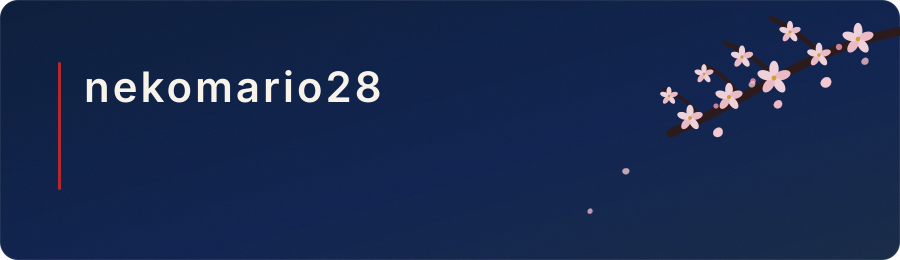
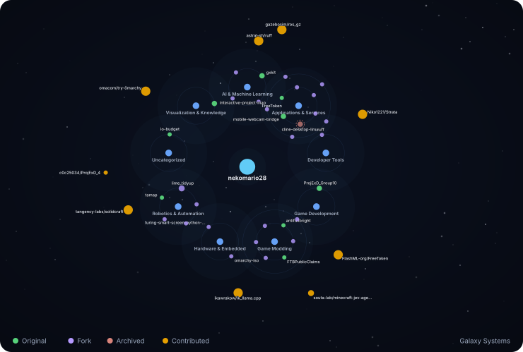
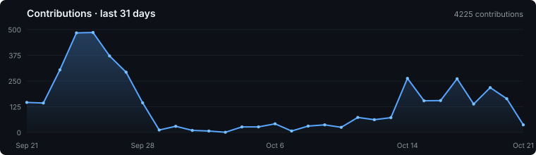

<!-- live-profile: direct-ipm | Envelope experiments remain under design-lab -->

  

  東京工科大学でコンピュータサイエンスを学んでいます。 
  個人開発とOSSへの貢献を中心に、コーディングエージェントも活用して開発しています。

### Selected work

- **Robotics / OSS:** [ROS 2 ↔ Gazebo (ros_gz)](https://github.com/gazebosim/ros_gz/pulls?q=author%3Anekomario28) に4件の修正PRがマージされました。変更内容は[Zennの記事](https://zenn.dev/yuu7/articles/ros2-gazebo-upstream-fixes)にまとめています。
- **Robot simulation:** [Sim-Agent の移動ロボット・ナビゲーション関連PR](https://github.com/syun88/Sim-Agent/pull/5)。
- **Applications:** [Melba](https://github.com/nekomario28/melba)（Rust製Linux音楽クライアント）、[Mobile Webcam](https://github.com/nekomario28/mobile-webcam-bridge)（Android端末をPCのWebカメラとして利用）。
- **Developer tools:** [gxkit](https://github.com/nekomario28/gxkit)（開発成果物を検査するツール群）。

技術記事: [Zenn](https://zenn.dev/yuu7)

 

  

  ©2023 暁なつめ・三嶋くろね／KADOKAWA／このすば爆焔製作委員会

 

<h2 align="center">Projects</h2>

公開プロジェクトをマップで見る ↓

  

 

  

